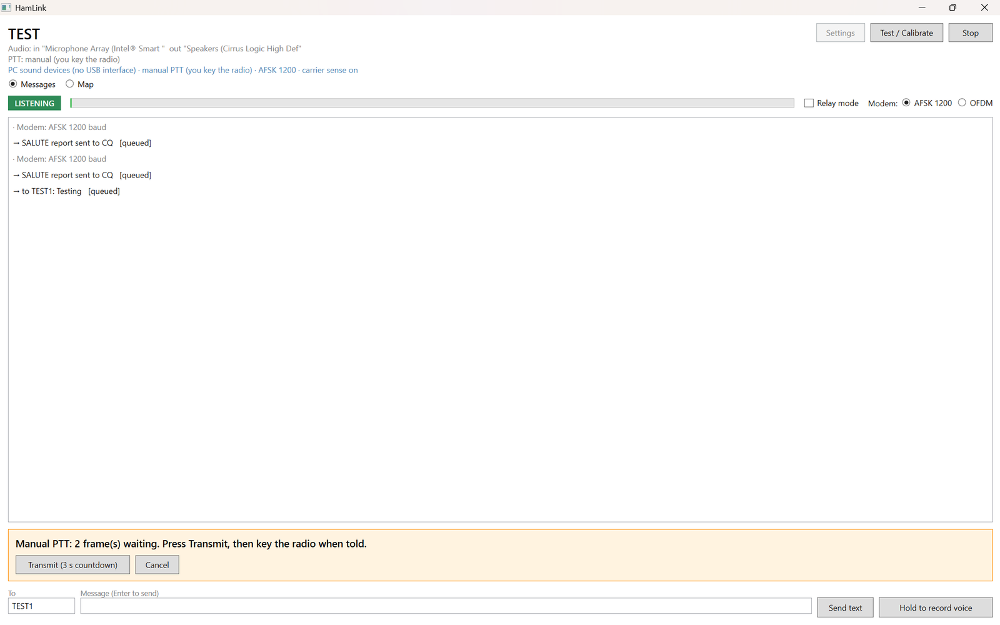
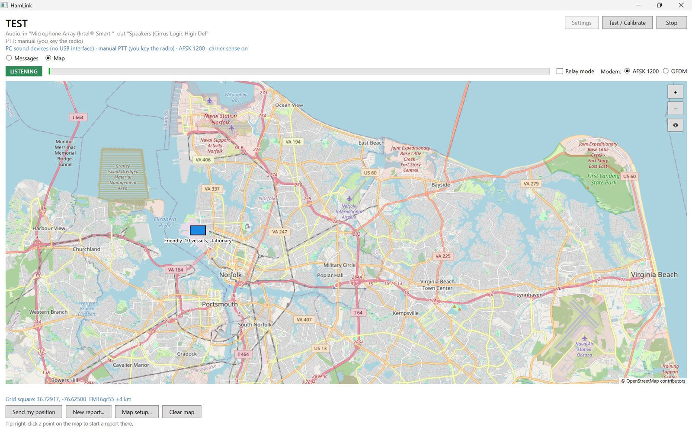

# HamLink

Text messages, voice clips, position reports and SALUTE situation reports over cheap handheld VHF/UHF FM radios
(Baofeng UV-5R class). A **Windows 11 PC** or an **Android phone** is the modem; the radio connects through a DigiRig
(audio + PTT), a radio with a built-in KISS TNC, or, for a first test, plain acoustic coupling. A simplex
store-and-forward relay mode lets stations that can't hear each other talk through a third station on a hilltop.

Amateur radio only: callsign required, no encryption, publicly documented protocol.

## Screenshots (Windows 11)

**Messages.** Text and SALUTE reports queued for transmission in manual-PTT mode: the app counts down, you key the radio.



**Map.** OpenStreetMap tiles with a SALUTE report on the map ("Friendly: 10 vessels, stationary"). Your position comes
from a grid square, typed coordinates, the Windows location service or a serial GPS. Right-click any point on the map to
start a report there.



## What it does
* **Five modems on the audio link:** AFSK 1200 baud (Bell 202 + HDLC, the default); OFDM (COFDMTV, from Rattlegram);
  **PSK 2400** and **PSK 3600** (QPSK / 8-PSK, about 2x and 2.4x the throughput of AFSK; 3600 needs a strong signal);
  and **MT63-2000, slow but robust**: about 7 times the airtime of AFSK, but in simulation it still delivered at -4 dB
  SNR, where AFSK needs about +6 dB.
* **Reliable delivery:** acknowledgements and retries (selective-repeat ARQ), flood relay with duplicate suppression,
  carrier sense, automatic station ID.
* **FX.25 error correction on AFSK**, on by default: repairs damaged bytes in each frame (up to 8, 16 or 32 depending on
  the setting), while stations without FX.25 still read frames that arrive intact.
* **Voice as store-and-forward clips** (Codec2 700C): a 5 s clip is about 500 bytes.
* **Reports on a map:** position and SALUTE reports, coloured by the reporter's assessment, fading with age. Report types
  are JSON files (`hamlink/schemas/`), so adding one needs no code.
* **Station SITREP:** a nine-field drop-down status report (conditions, state, home/mobile/portable, then power, water,
  sanitation, medical, grid communications and transportation, which may be omitted when all is OK).
* **Receiver tested on real packet audio:** on the WA8LMF TNC Test CD it decodes 971 error-free frames from the
  de-emphasised traffic track and 1001 from the flat one, with no false frames from an hour of noise.

## Status
Review build 0.1.2. **The Windows app builds and runs on Windows 11**; messages, the map and reports have been used on
one PC. **Not yet tested:** two stations exchanging messages, any real radio, and the Android app, which has never been
compiled. Bug reports with the exact error text are the most useful feedback right now. Windows logs errors with stack
traces to `%LOCALAPPDATA%\HamLink\error.log`.

## Download (Windows)
Get `HamLink-<version>-win-x64.zip` from the newest release on the [Releases page](https://github.com/MRC757/hamlink/releases), unzip
it anywhere and run `HamLink.exe`. Nothing to install: .NET is included, and it runs on an air-gapped PC. The program is
not code-signed, so Windows SmartScreen may warn the first time: choose *More info > Run anyway*.

## Build and run from source (Windows)
Needs the .NET 8 or 9 SDK and internet access once, for NuGet.

```powershell
git clone https://github.com/MRC757/hamlink.git
cd hamlink\hamlink\windows
powershell -File build.ps1        # self-contained build in .\publish
.\publish\HamLink.exe
```

The `publish` folder runs on any Windows 10/11 PC without installing .NET, including an air-gapped one. In VS Code, open
the repository root: *Terminal > Run Build Task* builds, F5 runs under the debugger (C# Dev Kit extension).

First run: **Settings** (your callsign, audio devices, PTT), then **Start**. With no radio interface, choose PTT *Manual*
and the Windows default speakers and microphone; `hamlink/docs/TESTING.md` walks through a staged bring-up from two PCs
with no radio to a DigiRig on the air.

## Documentation
| | |
|---|---|
| [hamlink/README.md](hamlink/README.md) | Full overview: modes, radio interfaces, wiring, what has and hasn't been verified, known issues |
| [hamlink/windows/README.md](hamlink/windows/README.md) | Windows build, DigiRig setup, KISS TNC, maps |
| [hamlink/docs/TESTING.md](hamlink/docs/TESTING.md) | Staged test plan, from no radio to on the air |
| [hamlink/docs/PROTOCOL.md](hamlink/docs/PROTOCOL.md) | On-air format |
| [hamlink/docs/MAPS_AND_REPORTS.md](hamlink/docs/MAPS_AND_REPORTS.md) | Positions, SALUTE, map behaviour |
| [hamlink/docs/DSP_IMPROVEMENTS.md](hamlink/docs/DSP_IMPROVEMENTS.md) | Receiver design and Test CD results |

## Licence
GPL-3.0-or-later ([hamlink/LICENSE](hamlink/LICENSE)). Third-party components keep their own licences: Codec2
(LGPL-2.1), the aicodix Rattlegram modem (0BSD-style) and the MT63 modem from fldigi (GPL-3.0-or-later). Map data ©
OpenStreetMap contributors.
