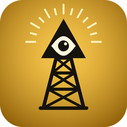
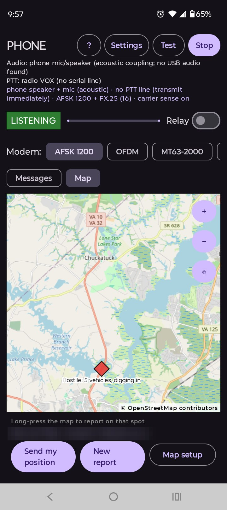
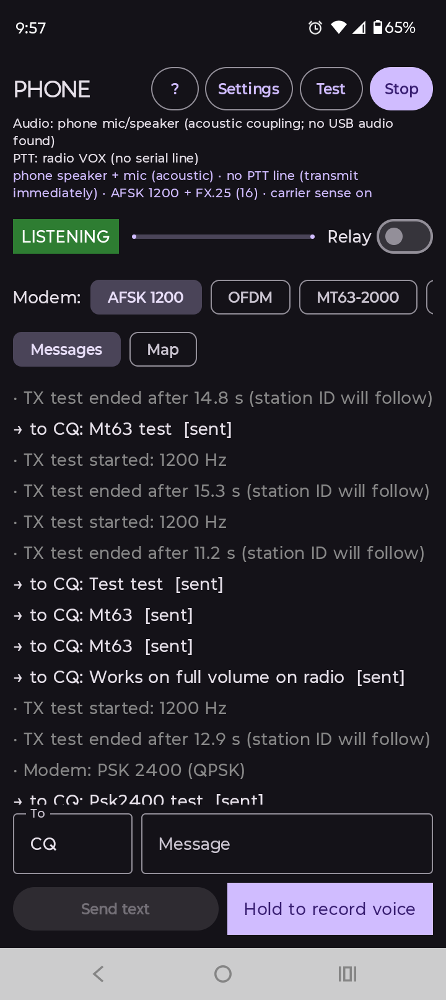
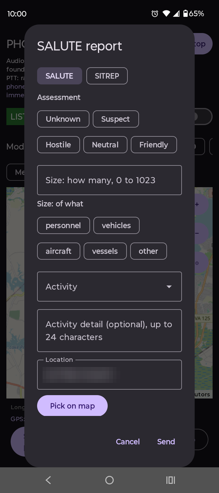
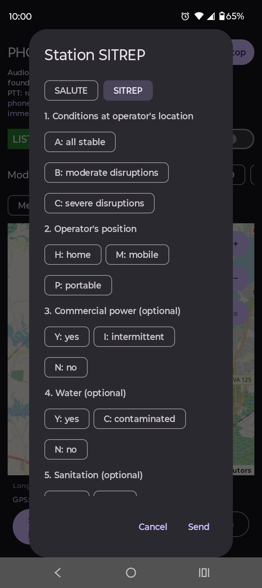
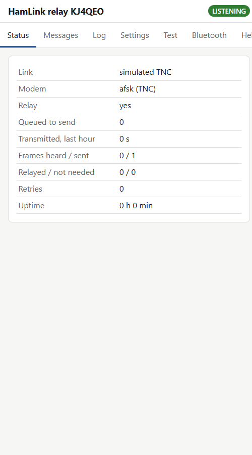
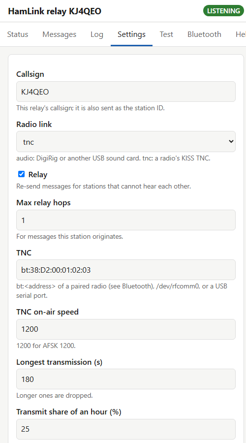

# HamLink

Text messages, voice clips, position reports and SALUTE situation reports over cheap handheld VHF/UHF FM radios
(Baofeng UV-5R class). A **Windows 11 PC** or an **Android phone** is the modem; the radio connects through a DigiRig
(audio + PTT), a radio with a built-in KISS TNC, or, for a first test, plain acoustic coupling. A simplex
store-and-forward relay mode lets stations that can't hear each other talk through a third station on a hilltop, which
can be an unattended **Raspberry Pi** set up from a phone's browser.

Amateur radio only: callsign required, no encryption, publicly documented protocol.

## Screenshots (Windows 11)

**Messages.** Text and SALUTE reports queued for transmission in manual-PTT mode: the app counts down, you key the radio.


**Map.** OpenStreetMap tiles with a SALUTE report on the map ("Friendly: 10 vessels, stationary"). Your position comes
from a grid square, typed coordinates, the Windows location service or a serial GPS. Right-click any point on the map to
start a report there.


## Screenshots (Android)

<table>
<tr>
<td width="50%"></td>
<td width="50%"></td>
</tr>
<tr>
<td><b>Map</b> (dark mode). A SALUTE report ("Hostile: 5 vehicles, digging in") placed by long-pressing the map, the
phone's GPS position, and buttons to send a position or start a report.</td>
<td><b>Messages.</b> Test tones and messages sent from the phone over Baofeng radios: MT63 test messages, then a switch
to PSK 2400. <b>?</b> opens Help; the modem can be changed live from the header.</td>
</tr>
<tr>
<td width="50%"></td>
<td width="50%"></td>
</tr>
<tr>
<td><b>SALUTE report.</b> Assessment, size, activity, location (typed, the phone's position, or <i>Pick on map</i>),
equipment and time, sent to everyone in range.</td>
<td><b>Station SITREP.</b> Conditions at the operator's location (A/B/C, which also colours the station on the map),
home/mobile/portable, then optional power, water, sanitation, medical, communications and transportation.</td>
</tr>
</table>

GPS coordinates are blurred in these screenshots.

## What it does
* **Five modems on the audio link:** AFSK 1200 baud (Bell 202 + HDLC, the default); OFDM (COFDMTV, from Rattlegram);
  **PSK 2400** and **PSK 3600** (QPSK / 8-PSK, about 2x and 2.4x the throughput of AFSK; 3600 needs a strong signal);
  and **MT63-2000, slow but robust**: about 7 times the airtime of AFSK, but in simulation it still delivered at -4 dB
  SNR, where AFSK needs about +6 dB.
* **Reliable delivery:** acknowledgements and retries (selective-repeat ARQ), flood relay with duplicate suppression,
  carrier sense, automatic station ID.
* **FX.25 error correction on AFSK**, on by default: repairs damaged bytes in each frame (up to 8, 16 or 32 depending on
  the setting), while stations without FX.25 still read frames that arrive intact.
* **Voice as store-and-forward clips** (Codec2 700C): a 5 s clip is about 500 bytes.
* **Reports on a map:** position and SALUTE reports; SALUTE icons take the reporter's assessment colour, each station
  the colour of its latest SITREP, and icons fade with age. Report types are JSON files (`hamlink/schemas/`), so adding
  one needs no code. **Offline map files** (MBTiles) work with no internet; `hamlink/tools/make_mbtiles.py` builds one
  from USGS topo maps or your own tile server.
* **Station SITREP:** an eight-field status report (conditions, home/mobile/portable, then power, water, sanitation,
  medical, grid communications and transportation, which may be omitted when all is OK).
* **Reports to one station:** SALUTE and SITREP reports can go to everyone (CQ) or to one heard station, which
  acknowledges them. Positions always go to everyone.
* **Stations page:** messages one station at a time, with the station's SITREP colour, last heard, distance and
  direction, unread counts and a link to the map. Messages are kept for 5 days.
* **Monitor all traffic** and **Listen on all modems** (both off by default): show messages between other stations,
  and hear stations on any of the five modems. A relay re-sends each message on the modem it arrived on.
* **Built-in Help** on both apps: equipment for each modem, the Stations page, offline maps, troubleshooting.
* **Receiver tested on real packet audio:** on the WA8LMF TNC Test CD it decodes 971 error-free frames from the
  de-emphasised traffic track and 1001 from the flat one, with no false frames from an hour of noise.

## Status
Review build 0.2.2. **The Windows app runs on Windows 11 and the Android app on a phone.** The two have exchanged
messages, reports and relayed traffic, and **MT63** messages over **Baofeng radios**. The cable used for that radio test
has built-in noise cancelling that only MT63 survives, so **AFSK, PSK and OFDM over radio** still need testing with a
DigiRig or another interface without audio processing. Bug reports with the exact error text are the most useful feedback
right now. Windows logs errors with stack traces to `%LOCALAPPDATA%\HamLink\error.log`.

## Download
From the newest release on the [Releases page](https://github.com/MRC757/hamlink/releases):
* **Windows:** `HamLink-<version>-win-x64.zip`. Unzip it anywhere and run `HamLink.exe`. Nothing to install: .NET is
  included, and it runs on an air-gapped PC. The program is not code-signed, so Windows SmartScreen may warn the first
  time: choose *More info > Run anyway*.
* **Raspberry Pi:** `install.sh` (above) fetches `libhamlink_api-linux-aarch64.so` from the release by itself. The SD
  card image, `hamlink-relay-<version>.img.xz`, is attached from the next release on.
* **Android 8.0+:** `HamLink-<version>-android.apk`. Open it on the phone and allow *Install unknown apps*. It is a test
  build signed with a development key, not a Play Store release.

## Raspberry Pi hilltop relay (preview)
`hamlinkd` runs the same core as an unattended relay on a Raspberry Pi (Zero 2 W or later). It works with a DigiRig on
any modem, or with a radio's Bluetooth KISS TNC. You set it up and check on it from a phone on the Pi's own Wi-Fi hotspot:
status, messages, live log, settings, test tones, Bluetooth pairing and Help, behind a password.

<table>
<tr>
<td width="50%"></td>
<td width="50%"></td>
</tr>
</table>

Install with `curl -sSL https://raw.githubusercontent.com/MRC757/hamlink/master/hamlink/pi/install.sh | bash` on
Raspberry Pi OS Lite (64-bit), or flash the ready-made SD card image. The image boots into the hotspot `hamlink-relay`
with the page at http://10.42.0.1/.

**Not yet run on a Pi.** Everything is tested in CI on ARM64, including a real install under systemd. Hardware tests
with a DigiRig and radios come next. Setup, hardening and safety limits: [hamlink/pi/README.md](hamlink/pi/README.md).

## Build and run from source (Windows)
Needs the .NET 8 or 9 SDK and internet access once, for NuGet.

```powershell
git clone https://github.com/MRC757/hamlink.git
cd hamlink\hamlink\windows
powershell -File build.ps1        # self-contained build in .\publish
.\publish\HamLink.exe
```

The `publish` folder runs on any Windows 10/11 PC without installing .NET, including an air-gapped one. In VS Code, open
the repository root: *Terminal > Run Build Task* builds, F5 runs under the debugger (C# Dev Kit extension).

First run: **Settings** (your callsign, audio devices, PTT), then **Start**. With no radio interface, choose PTT *Manual*
and the Windows default speakers and microphone; `hamlink/docs/TESTING.md` walks through a staged bring-up from two PCs
with no radio to a DigiRig on the air.

## Documentation
| | |
|---|---|
| [hamlink/README.md](hamlink/README.md) | Full overview: modes, radio interfaces, wiring, what has and hasn't been verified, known issues |
| [hamlink/windows/README.md](hamlink/windows/README.md) | Windows build, DigiRig setup, KISS TNC, maps |
| [hamlink/pi/README.md](hamlink/pi/README.md) | Raspberry Pi relay: install, web page, Bluetooth radios, hilltop hardening |
| [hamlink/docs/RASPBERRY_PI.md](hamlink/docs/RASPBERRY_PI.md) | Pi plan: hardware, solar and battery sizing, phases |
| [hamlink/docs/TESTING.md](hamlink/docs/TESTING.md) | Staged test plan, from no radio to on the air |
| [hamlink/docs/PROTOCOL.md](hamlink/docs/PROTOCOL.md) | On-air format |
| [hamlink/docs/MAPS_AND_REPORTS.md](hamlink/docs/MAPS_AND_REPORTS.md) | Positions, SALUTE, SITREP, map behaviour |
| [hamlink/docs/OFFLINE_MAPS.md](hamlink/docs/OFFLINE_MAPS.md) | Offline map files and where to get them |
| [hamlink/docs/help/HELP.md](hamlink/docs/help/HELP.md) | The in-app Help: equipment, offline maps, troubleshooting |
| [hamlink/docs/DSP_IMPROVEMENTS.md](hamlink/docs/DSP_IMPROVEMENTS.md) | Receiver design and Test CD results |

## Licence
GPL-3.0-or-later ([hamlink/LICENSE](hamlink/LICENSE)). Third-party components keep their own licences: Codec2
(LGPL-2.1), the aicodix Rattlegram modem (0BSD-style) and the MT63 modem from fldigi (GPL-3.0-or-later). Map data ©
OpenStreetMap contributors.
